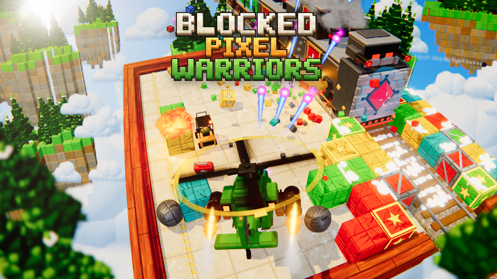

# Blocked Pixel Warriors (3D)

> Voksel helikopter, zırhlı trene karşı: arcade nişancı oyunu. Three.js / WebGL2 ile yazıldı, tek dosyalık derleme.
> Depo: https://github.com/arargame/blockedpixelwarriors

Sahne `captures/ref/keyart.png` tanıtım görseline göre kuruldu. Kamera açısı, küp dizilimi,
tren, helikopter, adalar, ışık ve renk tonları o görselle aynı.



## Hemen oyna

`dist/index.html` dosyasına çift tıkla. Sunucu gerekmez: tüm kod, modeller ve dokular tek dosyanın
içinde.

### Görev

Trenin vagonlarındaki **kırmızı, yeşil ve mavi** kutuları vurup aşağı düşür. Mühendis forkliftiyle
onları en soldaki iskele sütununa dizer, kargo helikopteri de gelip götürür.
**100 kırmızı + 100 yeşil + 100 mavi** paket teslim edilince **görev tamamlanır**.

### Kontroller (klavye, pilot tarzı: helikopterin kendi gövdesine göre)

- **W** burnun baktığı yöne ileri, **S** kuyruğa doğru geri gider, **A / D** gövdenin soluna / sağına kayar.
- **← / →** helikopteri döndürür (Q / E de çalışır). ↑ / ↓ kullanılmaz.
- Dokunmatik ekranda ya da fareyle sürükleyerek: ekrana göre joystick gibi çalışır, burun gidilen yöne döner.
- Ayarlar: `GameConfig.heli` (hız, ivme, dönüş hızı). Doğrulama: `node tools/controltest.mjs`.

### Silahlar (otomatik ateş)

- **Varsayılan:** kanat altı podların önünden, sağ ve sol sırayla tek atış.
- **Akıllı nişan:** hedefe dönmen yeterli. Burnun ±17°'lik konisinde, 18 birime kadar en uygun hedef
  kilitlenir. Namlular yukarı/aşağı ve birkaç derece yana açı alıp hedefin merkezine ateş eder; kilitli
  hedefin üstünde dönen beyaz köşeli nişangâh görünür. Nişanlı atışlar gerçek 3D çarpışma kullanır:
  aradaki blokların üstünden ve trenin zırhının yanından geçip hedeflenen parçaya ulaşır.
  Kalkan açıkken taretler elmastan önce gelir. Kilit yoksa düz ileri ateş eder.
  Ayar: `GameConfig.heli.aimCone / aimRange`.
- **Korunan kargo:** trenden düşen kırmızı/yeşil/mavi kutulara akıllı nişan, güdümlü roket ve 8 yön
  atışı **asla kilitlenmez**; zincirleme patlama ve roket sıçrama hasarı da onlara geçmez. Elle düz ateş
  ise hâlâ kırabilir. Kırılırsa ekranda **CARGO LOST!** yazar.

### Destekler (supply)

**Destek blokları** (yıldızlı, altın çerçeveli) patlayınca her zaman bir destek düşer. Türler eşit
dağılır (5 tür, %20'şer). `PowerUps.js` → `POWERUPS` listesine eklenen her tür otomatik olarak havuza girer.
**Mıknatıs** (Blocked'daki gibi): helikopter ~5 birim yaklaşınca destek sabit bir çekimle kıvrılarak sana
gelir ve toplanır. T/D/R/G 8-15 sn arası rastgele bir süre etkin kalır.

- **T – Üçlü Ateş:** burun topundan 3'lü yelpaze plazma
- **D – 8 Yön:** 8 yöne ateş; her yön, o taraftaki hedefe göre yukarı/aşağı nişan alır
- **R – Güdümlü Roket:** yakındaki rastgele hedeflere güdümlü roketler (Blender'da modellendi, duman izi ve alevle)
- **H – Tamir Çantası:** anında **+35 can**
- **G – Mücevher Gücü:** sekizgen elmas (5 renk). Süre boyunca tüm atışlar elmasın rengini alır ve %25 fazla hasar verir.
- Etkin olanlar sağ altta sohbet akışı gibi listelenir (ince beyaz çerçeveli çubuklar).

Ayarlar: `GameConfig.supply`. Doğrulama: `node tools/poweruptest.mjs`.

### Ekran göstergeleri (HUD)

- **Sol alt, alttan yukarı:**
  - Helikopterin canı (100 can, 5'erlik 20 parça). %25'in altında kırmızı yanıp söner ve helikopterden
    ince kara duman çıkar.
  - Üstünde **kargo helikopteri geri sayımı** (2:00'dan geriye). Son 10 saniyede büyüyüp yanıp söner,
    sarı onluk sayaca geçer; helikopter gelince yükleme sayacına döner.
  - En üstte **görev paneli**: teslim edilen kırmızı / yeşil / mavi paketler (x/100) ve iskeledeki paket sayısı.
- **Üst orta: zırhlı tren paneli.** Soldan sağa vagon vagon kartlar; her kartta o vagonun parçaları (elmas,
  taretler, renkli kargo küpleri) dikey çubuk olarak durur. Hasar aldıkça azalır, yok olunca boş kalır,
  tamamen biten vagonun üstü çizilir. Sağda tur, hız modu, **🛡 KALKAN** durumu ve toplam yüzde görünür.
- Her hasarda ekranın kenarında Blocked'daki gibi kırmızı bir hale belirir ve 2 saniyede söner.

### Zırhlı tren

- A ile B arasında mal taşır gibi her turda yön değiştirir. Her tur rastgele **HIZLI** (hiç durmaz),
  **NORMAL** veya **YAVAŞ** gider. Normal ve yavaş turlarda tahtanın üstünde **3 sn durabilir**;
  dururken taretler 2,5 kat hızlı ateş eder.
- **Taretler** helikopteri izler. Her atışta **iki namlunun ikisi de** birer gri mermi atar: Blender'da
  modellenen, namlu kalınlığında gri mermiler, namlunun baktığı yönde gider. Taret hızlı dönen helikopterin
  gerisinde kalırsa mermi de geride kalır. Namlular her atışta geri teper.
- **Taretler kırılabilir:** hasar aldıkça önce duman, sonra kıvılcım çıkarırlar. Canı bitince patlarlar:
  taret kafası namlularıyla birlikte koparak uçar, yere çarpıp seker ve yanarak kaybolur. Etrafa koyu metal
  parçalar saçılır, yerinde yanan bir kütük kalır.
- **Sarı pirinç toplar** (trenin altından çıkan sarı borular) helikoptere nişan almaz. Rastgele bir top,
  **kendi namlusunun yönünde** yuvarlak bir demir gülle fırlatır: hafif bir yay çizer ve arkasında duman
  bırakır, isabet ederse 10 hasar verir.
- **Lokomotifin başı en güçlü yerdir:** taretlerden biri bile ayaktayken elmasın önünde mavi bir enerji
  kalkanı vardır ve hasarın sadece %5'i geçer. **Son taret de kırılınca kalkan parçalanır**
  ("GEM SHIELD DOWN") ve elmas tam hasar alır.
- Trene çarpmak **25 can** götürür: helikopter geri savrulur ve 1,5 sn yanıp söner.
- Aynı tren, lokomotifteki elmas yok edilene (%0) kadar tekrar tekrar gelir. Yok ettiğin taretler ve
  elmasa verdiğin hasar kalıcıdır; kargo vagonları her turda yeni küplerle dolu gelir. Yok edilen tren
  yanarak hızlanır ve birkaç saniyede sahneyi terk eder, sonraki dalgada yeni tren gelir.
- Geçerken rayın sağındaki iki sütunda boşalan karelere vagonlardan yeni blok bırakır.

### Lojistik: mühendis, forklift, iskele ve kargo helikopteri

- **Trenden düşen kutular:** vagondan vurulan küp rayın **solunda**, forkliftin ulaşabileceği en yakın
  boş kareye düşer. Kırmızı, yeşil ve mavi küpler **kargo** olur: üzerlerinde koli bandı, barkodlu etiket
  ve "bu taraf yukarı" okları vardır. Sarılar sıradan blok olarak kalır.
- **Mühendis:** kasketli, üniformalı, çizmeli bir asker sarı bir forklift kullanır (ikisi de Blender'da
  modellendi). Karolar arasında yol bularak (BFS) en yakın kargoya gider, çatallarını altına sokup kaldırır
  ve kutuyu **en soldaki sütuna (iskele)** taşır. Çalışırken turuncu tepe lambası yanıp söner.
  Önü bloklarla kapanırsa bekler; bloğu vurarak yolunu açabilirsin.
- **Hediye paketleri:** iskeleye bırakılan kutu, **altın kurdeleli ve fiyonklu bir hediye paketine**
  dönüşür. Paketler **vurulamaz**: mermiler içlerinden geçer. Hafifçe ışıldar ve alınmayı bekler. İskele
  sarı-siyah şeritle boyalıdır; önce zemin sırası dolar, o dolunca paketler ikinci kata dizilir (13 × 2 = 26 yer).
- **CH-47F Chinook kargo helikopteri** (Blender'da, fotoğraftaki sarı / yeşil / koyu kamuflajla):
  **her 2 dakikada bir** gelir. Soldan yaklaşır, iskele sütununun üstünde kameraya doğru döner ve paketleri
  sırayla (uzaktan yakına, üstteki önce) **vinç ile karnına çeker**. Yükleme bitince sola ve yukarı uçup
  gider. Pervane rüzgârı yerdeki karı savurur. Her paket görev sayacına eklenir (+100 puan).
- Ayarlar: `GameConfig.logistics` (`chinookInterval`, `goal`, `forkliftSpeed`, `dockCol`).
  Doğrulama: `node tools/logisticstest.mjs`.

### Bloklar

3 tip vardır: normal, **zırhlı** (çelik kafesli, ~3 kat dayanıklı) ve **destek bloğu** (her yeni blok
için %20 şans; zırhlı %20, kalanı normal). Bir blok patlayınca ona **değen aynı renkteki bloklar zincirleme**
patlar (her halka daha çok puan getirir). Tahtadaki bloklar kendiliğinden geri gelmez: yeni bloklar sadece
trenden gelir. En soldaki sütun iskeledir, orada blok olmaz.

## Geliştirme

```bash
npm install
npm run dev      # http://localhost:5173
npm run build    # dist/index.html (tek dosya)
```

URL parametreleri:

| Parametre | Açıklama |
|---|---|
| `?quality=high\|medium\|low` | Görüntü kalitesi (telefonda otomatik `medium`) |
| `?poster&logo` | Tanıtım görselindeki kareyi sabit olarak çizer (karşılaştırma için) |
| `?cam=x,y,z,pitch,yaw,fov,lensK` | Kodu değiştirmeden kamera ayarı dene |
| `?procedural` | Blender helikopteri yerine eski kodla üretilen modeli kullan |

## Görsel teknikler

- **Kamera ve mercek:** tanıtım görseline `tools/overlay.mjs` ile oturtuldu (geniş açı, soldan, sağa dönük).
  Üstüne hafif bir fıçı mercek bükmesi (`LensPass`) eklendi; görseldeki "diorama" hissi buradan gelir.
- **Arka plan eğimi:** gökyüzü ve adalar ayrı bir grupta, kameraya doğru 17° eğik durur. Böylece tahta
  dik açıdan görünürken adaların kayalık yüzleri, şelaleler ve ufuk aynı karede görünür (görseldeki
  perspektif hilesi).
- **Zemin:** mermer fotoğrafından kalebodur karolar (`TileFloorMaterial.js`). Blok ızgarasıyla hizalı
  1,5 birimlik kareler; her karoda fotoğrafın farklı bir bölümü, 90°'lik rastgele dönüş, derz ve pah var.
- **Karolarda kar:** kar yağarken taneler tek tek karolara konar, yamalar halinde birikir; yağış azalınca
  erir (sıcak noktalarda daha hızlı, bu yüzden parça parça). Helikopterin pervane rüzgârı altındaki karı
  daire şeklinde savurur, forkliftin tekerlekleri iz bırakır, Chinook geniş bir alanı temizler. Kar
  örtüsü işlemcide düşük çözünürlüklü bir ızgarada hesaplanır ve karo shader'ında ince taneli bir serpinti
  olarak çizilir (`FloorSnow`, `src/world/Snow.js`).
- **Raylarda kar:** dalgalar halinde gelip giden hafif kar yağışı. Raylarda her travers aralığı rastgele
  bir miktara kadar birikir. Tren geçerken kar erir ve savrulur, 2-9 sn sonra yeniden dolar. Ara sıra
  5-12 sn süren tipiler gelir.
- **Küpler:** yuvarlatılmış köşeli küpler (instanced), Voronoi çatlaklı normal map, yumuşak kar yığınları.
- **Araçlar:** tren `VoxelModelBuilder` ile kenarları pahlı kutulardan kurulur; `VoxelMaterial` her
  yüzeye mikro-voksel desen ve derz basar.
- **Mermiler:** taret mermisi, roket, forklift ve Chinook Blender'da modellendi; demir gülleler kendi
  ekseninde döner. Hepsi hız yönüne göre dönen instanced mesh olarak çizilir.
- **Efektler:** plazma kuyrukları, iz mermileri, ateş topları, kırılan küp parçaları, baca dumanı,
  kopan taret enkazı, kalkan kıvılcımları.
- **Görüntü sonrası işlem:** MSAA + HDR → ön plan bulanıklığı (çam ağaçları) → parlama (bloom) →
  renk ayarı → mercek → ACES ton eşleme.
- **Logo:** `src/ui/VoxelLogo.js` canvas üzerinde voksel harfler çizer (tank figürlü A dahil).

## Blender modelleri

| Model | Betik | Çıktı |
|---|---|---|
| Helikopter | `tools/blender/build_heli.py` | `assets/models/helicopter.glb / .blend` |
| Güdümlü roket | `tools/blender/build_rocket.py` | `assets/models/rocket.glb / .blend` |
| Taret mermisi, forklift + mühendis asker, CH-47F Chinook | `tools/blender/build_props.py` | `assets/models/bullet.glb`, `forklift.glb`, `chinook.glb` (+ `.blend`) |

Oyun `.glb` dosyalarını yükler; yüklenemezse basit yedek modellere döner. Ayrıntılar: `tools/blender/README.md`.

## Klasörler

```
src/core       Game (ana döngü), RenderPipeline, Input, görüntü sonrası işlem geçişleri
src/world      Tahta, ray, adalar, çamlar, bulutlar, gökyüzü, kar (World cephesi)
src/entities   Helikopter, tren, blok alanı, dikenli toplar, destekler, lojistik (forklift, iskele, Chinook)
src/fx         Partikül, mermi, enkaz, billboard toplu çizimi
src/textures   Prosedürel doku ve malzeme kütüphanesi, karo zemin shader'ı
src/ui         HUD ve voksel logo
src/config     GameConfig (yerleşim, kamera, oyun ayarları), Palette (tüm renkler)
tools          ekran görüntüsü, kamera eşleme, oyun testleri, Blender betikleri
```

Renkler `src/config/Palette.js`'te, kamera, tahta yerleşimi ve oyun ayarları `src/config/GameConfig.js`'te,
başlangıç küp haritası `src/entities/BlockField.js` içindeki `MAP` dizisinde.

## Test araçları (görünmez Chromium)

```bash
node tools/screenshot.mjs captures/out.png 1672 941 "&logo"   # poster karesi
node tools/overlay.mjs -8.6,11.7,13.8,42,19,60,0.18 out.png    # yerleşimi tanıtım görselinin üstüne çiz
node tools/playtest.mjs                                        # genel oynanış testi
node tools/traintest.mjs                                       # akıllı nişan, çarpışma, tren turları, duruşlar
node tools/weapontest.mjs                                      # çift taret mermisi, toplar, kırılan taretler, kalkan
node tools/logisticstest.mjs                                   # forklift, iskele, Chinook, geri sayım, görev sonu
node tools/snowtest.mjs                                        # karolarda kar birikmesi ve erimesi
node tools/verify-dist.mjs                                     # dist dosyasını file:// ile aç
```

## Tanıtım görseliyle bilinen farklar

Tanıtım görseli yapay zekâyla üretilmiş bir illüstrasyon; perspektifi fiziksel olarak tutarlı değil
(sol duvar, uzak duvar ve ray tek bir kamerayla aynı anda o açılarda görünemiyor). Kamera bu yüzden en
yakın tutarlı çözüme oturtuldu. Elle boyanmış detay seviyesi (kayalardaki fırça dokusu, her çamın ayrı
çizimi) gerçek zamanlı çizimde birebir değil; yerleşim, açı, renkler ve nesnelerin tasarımı aynı.
